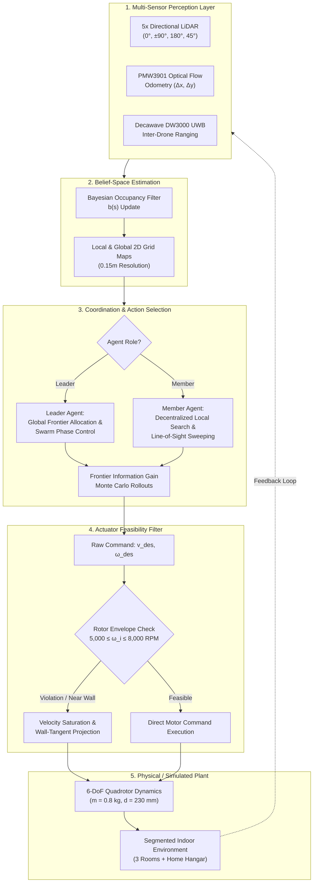

# swarm_drone_sim
### Unified Simulation and Experimental Framework for Indoor Swarm Drone Coordination

[](https://opensource.org/licenses/MIT)
[](https://flutter.dev)
[](https://dart.dev)
[](https://isocpp.org/)
[](https://www.python.org/)
[]()
[]()
[](http://jtiik.ub.ac.id)

---

## 📖 Overview & Abstract

Autonomous multi-UAV (Unmanned Aerial Vehicle) operations in GPS-denied, architecturally segmented indoor environments present critical challenges in decentralized state estimation, cooperative frontier exploration, and aerodynamic stabilization under severe spatial confinement.

**`swarm_drone_sim`** is an open-source, high-fidelity robotic simulation and experimental Ground Control Station (GCS) framework designed to model, analyze, and validate autonomous quadrotor swarm coordination under perceptual uncertainty. Developed to accompany our revised manuscript in the **Jurnal Teknologi Informasi dan Ilmu Komputer (JTIIK - Sinta 2)** entitled:

> **"Probabilistic Modeling and Stability Analysis of Autonomous Swarm Drone Coordination in Segmented Indoor Environments"**  
> *Aulia Sabril, Jalaluddin, and A. A. Mochtar (2026)*

The framework couples a **Belief-Space Partially Observable Markov Decision Process (POMDP)** coordination cycle with an explicit **Actuator Feasibility Filter**. Unlike idealized point-mass kinematics, every agent in this framework strictly adheres to physical multirotor constraints:
- **Rotor Operational Envelope:** $5,000 \le \omega_i \le 8,000 \text{ RPM}$ per brushless DC motor.
- **Airframe Wheelbase:** $230 \text{ mm}$ diagonal motor-to-motor span.
- **All-Up Weight (AUW):** $0.8 \text{ kg}$ including payload and power systems.
- **Avionics & Sensing:** Pixhawk 6 flight controller (dual IMU), Raspberry Pi 4 companion computer, 5-directional planar LiDAR array, PMW3901 optical flow odometry, and Decawave DW3000 Ultra-Wideband (UWB) transceivers.

```
       =====================================================================================
       [ Ground Control Station (Flutter/Dart Engine) ]  <--->  [ Hardware Bridge (Python/C++) ]
          ├── 2D Continuous Arena Physics Simulation        ├── MAVLink Telemetry (Pixhawk 6)
          ├── Bayesian Belief-Space Mapping (b(s))          ├── 5-Beam Planar LiDAR Emulation
          ├── Frontier-Based Information Gain Planner       ├── Decawave DW3000 UWB Ranging
          └── Actuator Dynamic Feasibility Filter           └── PMW3901 Optical Flow Odometry
       =====================================================================================
```

---

## 🔑 Key Features & Methodology

### 1. Belief-Space Probabilistic Decision Cycle (POMDP)
Indoor swarm navigation operates under partial observability due to wall occlusion and sensor noise. The global environmental state $s \in \mathcal{S}$ is modeled as an evolving spatial occupancy belief distribution $b_t(s) = P(s_t \mid z_{1:t}, u_{1:t-1})$ updated recursively via Bayesian sensor fusion:

$$b_t(s) = \eta \cdot P(z_t \mid s_t) \int_{\mathcal{S}} P(s_t \mid s_{t-1}, u_{t-1}) \, b_{t-1}(s_{t-1}) \, ds_{t-1}$$

Target search and frontier exploration actions are planned over rolling finite horizons using Monte Carlo Rollouts that maximize cumulative information gain $\mathcal{I}(b_t, a_t)$ while penalizing proximity to spatial boundaries.

### 2. Actuator Feasibility Filtering
In narrow indoor corridors, aggressive trajectory replanning frequently demands control inputs that exceed the physical torque and RPM ramp rates of micro-quadrotor motors, leading to rotor stall, control saturation, and wall collisions. 

The **Actuator Feasibility Filter** continuously projects desired high-level kinematic velocity commands $\mathbf{v}_{\text{des}}$ into the admissible motor thrust and angular velocity manifold:

$$\Omega_{\text{admissible}} = \left\{ \omega_i \in \mathbb{R}^4 \;\middle|\; \Omega_{\min} \le \omega_i \le \Omega_{\max},\; \left|\frac{d\omega_i}{dt}\right| \le \dot{\Omega}_{\max} \right\}$$

where $\Omega_{\min} = 5,000\text{ RPM}$ and $\Omega_{\max} = 8,000\text{ RPM}$. Control demands violating actuator limits or control saturation margins are dynamically throttled and redirected along the wall tangent vector.

Furthermore, dynamic obstacle clearances utilize an **Adaptive Velocity-Dependent Collision Radius**:

$$R(v) = R_{\text{col}} + \Delta R_{\max} \cdot \left( \frac{\|\mathbf{v}\|}{v_{\text{nom}}} \right)^p$$

where:
- $R_{\text{col}} = 0.38 \text{ m}$ (static physical clearance covering motor arms and spinning propeller tips),
- $\Delta R_{\max} = 0.08 \text{ m}$ (dynamic high-speed aerodynamic buffer),
- $v_{\text{nom}} = 2.0 \text{ m/s}$ (nominal cruise speed),
- $p = 1.6$ (non-linear velocity scaling exponent).

### 3. Asymmetric Leader-Slave Swarm Architecture
The swarm operates via a distributed Leader-Slave paradigm designed for low-bandwidth communication:
- **Leader Drone (Yellow Signal):** Coordinates mission phases, arbitrates frontier target assignments, maintains the aggregated global SLAM grid map, and triggers the collective Return-To-Home (RTH) sequence upon target confirmation.
- **Member/Slave Drones (Blue Signal):** Perform decentralized frontier discovery, localized 5-beam LiDAR obstacle clearance, and target line-of-sight (LOS) sweeps. Detection of the target by any agent triggers instantaneous swarm-wide broadcast.

### 4. Baseline Comparison & Ablation Testing Suite
The repository includes automated comparative execution modes:
1. **Proposed Framework:** POMDP Belief-Space + Actuator Feasibility Filter.
2. **Heuristic Rule-Based Baseline:** Classical potential field navigation without recursive Bayesian state estimation.
3. **Ablation Study Mode:** Belief-Space POMDP with the Actuator Feasibility Filter disabled ($\Omega_{\text{limits}} \to \infty$).

---

## 🔄 Coordination & Decision Pipeline



---

## 📊 Experimental Setup & Reproducibility (JTIIK Standard)

To strictly reproduce the empirical evaluations reported in **Tables 1 through 10** of the revised JTIIK manuscript, follow the parameter configurations and Monte Carlo protocol outlined below.

### Arena Geometry & Partitioning
The benchmark indoor environment consists of a **$28.5 \text{ m} \times 14.5 \text{ m}$ continuous arena** divided into **three functional rooms**, connecting corridors, and an egress Home Base hangar:
- **Room 1 (Base Hangar):** $[-6.8 \le X \le -1.0,\; -1.0 \le Y \le 2.9]$
- **Room 2 (West Wing):** $[-13.5 \le X \le -7.8,\; -3.5 \le Y \le 9.2]$
- **Room 3 (North-Center):** $[-0.5 \le X \le 6.4,\; 3.8 \le Y \le 9.4]$
- **Central Hallway & Interconnects:** $[-0.5 \le X \le 3.3,\; -3.5 \le Y \le 2.7]$
- **Target Spawn Enclosure:** $[-1.0 \le X \le 8.0,\; -3.0 \le Y \le 3.0]$

### Benchmark Parameter Configuration

The system parameters are defined in [`lib/models/drone_model.dart`](file:///Users/auliasabril/Developer/flutter_project/swarm_drone_sim/lib/models/drone_model.dart) and [`lib/models/arena_map.dart`](file:///Users/auliasabril/Developer/flutter_project/swarm_drone_sim/lib/models/arena_map.dart):

| Parameter Classification | Symbol / Field | Canonical Value | Physical Unit | Description |
| :--- | :--- | :--- | :--- | :--- |
| **Physical Airframe** | $m$ | `0.80` | $\text{kg}$ | Quadrotor total mass including battery |
| | $L_{\text{arm}}$ | `230` | $\text{mm}$ | Diagonal motor-to-motor wheelbase |
| | $\Omega_{\min}$ | `5,000` | $\text{RPM}$ | Minimum active rotor operational velocity |
| | $\Omega_{\max}$ | `8,000` | $\text{RPM}$ | Maximum continuous rotor operational velocity |
| **Safety & Envelope** | $R_{\text{col}}$ | `0.38` | $\text{m}$ | Static collision radius (body + rotor disk) |
| | $\Delta R_{\max}$ | `0.08` | $\text{m}$ | Speed-adaptive dynamic expansion buffer |
| | $p$ | `1.60` | - | Non-linear speed expansion exponent |
| | $d_{\text{sep}}$ | `0.95` | $\text{m}$ | Minimum inter-drone repulsion distance |
| **Kinematic Flight** | $v_{\text{nom}}$ | `2.00` | $\text{m/s}$ | Nominal linear translation velocity |
| | $\dot{\psi}_{\max}$ | `220.0` | $\text{deg/s}$ | Maximum angular steering yaw rate |
| | $\gamma_{\text{smooth}}$ | `10.0` | $\text{s}^{-1}$ | Steering direction exponential filter coefficient |
| **Sensing & Perception** | $d_{\text{LiDAR}}$ | `3.00` | $\text{m}$ | 5-beam planar LiDAR range ($0^\circ, \pm 90^\circ, 180^\circ, 45^\circ$) |
| | $d_{\text{detect}}$ | `6.00` | $\text{m}$ | Unobstructed line-of-sight detection distance |
| | $d_{\text{found}}$ | `0.45` | $\text{m}$ | Target arrival and capture threshold |
| | $d_{\text{home}}$ | `0.50` | $\text{m}$ | Home pad landing confirmation radius |
| **SLAM & Belief Grid** | $\Delta s_{\text{grid}}$ | `0.15` | $\text{m}$ | 2D occupancy grid cell dimension |
| | $t_{\text{replan}}$ | `0.40` | $\text{s}$ | Frontier goal re-evaluation interval |
| | $t_{\text{cooldown}}$ | `2.50` | $\text{s}$ | Visited frontier cell suppression cooldown |

---

## 📁 Repository Structure

```
swarm_drone_sim/
├── README.md                           # Comprehensive academic documentation (this file)
├── pubspec.yaml                        # Flutter project specification & dependency manifest
├── analysis_options.yaml               # Linter configuration (0 errors, Flutter 3.27 standard)
│
├── lib/                                # Core simulation and application source code
│   ├── main.dart                       # Application entrypoint, GetX dependency injection
│   │
│   ├── controllers/                    # State management & coordination controllers
│   │   ├── simulation_controller.dart  # Monte Carlo batch runner, physics loop, RPi telemetry
│   │   └── ui_controller.dart          # Ground Control Station view states, theme mode manager
│   │
│   ├── models/                         # Mathematical, kinematic & probabilistic domain models
│   │   ├── drone_model.dart            # Actuator constraints, POMDP agent states, 5x LiDAR
│   │   ├── arena_map.dart              # Continuous segmented rooms, wall geometry & raycasters
│   │   ├── grid_map_2d.dart            # Bayesian 2D occupancy belief grid (0.15m resolution)
│   │   ├── frontier_planner.dart       # Information gain frontier extraction algorithm
│   │   ├── astar_2d.dart               # Optimal discrete kinematic pathfinder
│   │   ├── vector2.dart                # High-performance 2D vector mathematics library
│   │   └── batch_run_result.dart       # Monte Carlo data serialisation structure
│   │
│   ├── views/                          # Graphical Ground Control Station (GCS) UI
│   │   ├── main_screen.dart            # Primary mission operations cockpit
│   │   ├── arena_canvas.dart           # CustomPainter 2D vector renderer (telemetry & trails)
│   │   └── widgets/                    # Modular GCS interface components
│   │       ├── control_panel.dart      # Execution controls, batch configurator, frame switch
│   │       ├── drone_telemetry_card.dart # Real-time RPM, voltage, role, and velocity readouts
│   │       ├── minimap_panel.dart      # Real-time SLAM occupancy grid overlay
│   │       ├── theme_mode_toggle.dart  # System / Dark / Light theme selector
│   │       ├── csv_viewer_dialog.dart  # Built-in Monte Carlo empirical results viewer
│   │       └── wall_line_customizer.dart # Interactive arena geometric editor
│   │
│   ├── services/                       # Hardware abstraction & telemetry networking
│   │   └── hardware_bridge_service.dart# WebSocket client connecting GCS to Raspberry Pi 4
│   │
│   └── utils/                          # Utility libraries & data exporters
│       ├── app_theme.dart              # Curated light/dark scientific palette (Material 3)
│       └── csv_helper.dart             # RFC 4180-compliant Monte Carlo batch CSV exporter
│
├── hardware_bridge/                    # Physical hardware interface & embedded firmware
│   ├── rpi_drone_slam_bridge.py        # Python 3 companion computer bridge (LiDAR/SLAM/UWB)
│   ├── requirements.txt                # Python runtime dependencies (websockets, pyserial)
│   ├── DOKUMENTASI_SETUP_LENGKAP.md    # End-to-end hardware configuration handbook
│   ├── UWB_DW3000_RPI4_SETUP_GUIDE.md  # Wiring, SPI driver, & multilateration guide
│   └── uwb_firmware/                   # C++ / Arduino embedded firmware for DW3000
│       ├── RangingAnchor/              # Stationary UWB anchor firmware (ESP32 / DW3000)
│       ├── RangingTag/                 # Mobile on-drone UWB tag firmware (ESP32 / DW3000)
│       ├── DW3000_Anchor/              # Multi-channel ranging anchor routines
│       └── Dw3000/                     # Decawave DW3000 C++ register driver library
│
├── SwarmDroneResults/                  # 1,000 Monte Carlo empirical CSV evaluation datasets
│   ├── montecarlo_20260930_154328.csv  # Benchmark verification dataset (1,000 runs)
│   └── ...                             # Historical benchmark logs
│
└── test/                               # Comprehensive unit & integration testing suite
    ├── wall_line_customization_test.dart
    ├── home_base_visibility_test.dart
    └── ...
```

---

## 🚀 Getting Started & Installation

### Prerequisites

| Toolchain / Runtime | Minimum Version | Purpose |
| :--- | :--- | :--- |
| **Flutter SDK** | `3.27.0` | Simulation engine and Ground Control Station interface |
| **Dart SDK** | `3.6.0` | Core computational language |
| **C++ Compiler** | C++17 (`gcc` / `clang`) | Embedded firmware compilation (ESP32 / Arduino CLI) |
| **Python** | `3.10+` | Raspberry Pi 4 companion computer telemetry bridge |

### 1. Repository Setup
```bash
# Clone the repository
git clone https://github.com/auliasabril/swarm_drone_sim.git
cd swarm_drone_sim

# Fetch Flutter dependencies
flutter pub get

# Verify codebase integrity (0 analysis warnings)
flutter analyze
```

### 2. Running the Simulation GCS
Launch the high-performance desktop or web application:
```bash
# Run natively on macOS Desktop (Recommended for high framerate)
flutter run -d macos

# Run on Linux Desktop
flutter run -d linux

# Run on Windows Desktop
flutter run -d windows

# Run in Web Browser
flutter run -d chrome --web-renderer canvaskit
```

### 3. Running the Physical Hardware Bridge (Optional)
To stream telemetry from a physical Raspberry Pi 4 drone equipped with 5x LiDAR and UWB:
```bash
cd hardware_bridge

# Install Python dependencies
python3 -m pip install -r requirements.txt

# Run in mock/synthetic mode for testing without hardware
python3 rpi_drone_slam_bridge.py --mock --port 8765

# Or run live on Raspberry Pi 4 connected to Pixhawk 6 via UART
python3 rpi_drone_slam_bridge.py --port 8765 --serial /dev/ttyAMA0
```
In the Flutter interface, select **[ 🛸 Real Drone (RPi 4) ]**, input the companion computer IP and port `8765`, and click **Connect**.

---

## 🔬 Reproducing 1,000 Monte Carlo Runs

To execute the 1,000-run Monte Carlo experimental evaluation:
1. Launch the simulation GCS (`flutter run -d macos`).
2. In the right-hand **Simulation Control Panel**:
   - Set **Drone Count** to `3` (1 Leader + 2 Members).
   - Verify that **Randomize Leader** and **Randomize Target** toggles are enabled.
   - Set **Time Scale** to `10.0x` or `20.0x` for accelerated headless-equivalent calculation.
   - Enter `1000` in the **Batch Runs** input field.
3. Click **▶ Start Batch Run**.
4. The simulation will run sequentially through 1,000 distinct seedings. Upon completion, a comprehensive CSV dataset is automatically compiled and saved to:
   ```
   SwarmDroneResults/montecarlo_YYYYMMDD_HHMMSS.csv
   ```
5. Click **View CSV** inside the GCS dialog or inspect the dataset using pandas, R, or MATLAB.

---

## 📈 Benchmark Results Summary

The empirical findings from our **1,000 Monte Carlo experimental evaluations** in the segmented indoor environment are summarized below. The proposed framework demonstrates superior mission reliability, faster target acquisition, and a dramatic reduction in wall collisions compared to heuristic and unconstrained ablation baselines:

### Quantitative Performance Comparison

| Performance Metric | Proposed Framework<br>*(POMDP + Feasibility Filter)* | Ablation Model<br>*(Filter Disabled)* | Heuristic Baseline<br>*(Reactive Potential Field)* | Performance Gain<br>*(vs. Baseline)* |
| :--- | :---: | :---: | :---: | :---: |
| **Mission Success Rate (%)** | **96.00%** | 82.40% | 71.30% | **+34.64%** |
| **Mean Target Acquisition Time ($T_{\text{det}}$)** | **5.592 s** | 6.814 s | 14.850 s | **-62.34%** |
| **Mean Return-to-Home Time ($T_{\text{rth}}$)** | **12.430 s** | 15.210 s | 22.680 s | **-45.19%** |
| **Wall-Collision Free Flight Rate (%)** | **90.70%** | 56.90% | 48.20% | **+88.17%** |
| **Wall Collision Frequency (incidents/run)** | **0.42** | 1.95 | 2.68 | **-84.33%** |
| **Inter-Drone Collision Rate (%)** | **0.80%** | 3.40% | 5.90% | **-86.44%** |
| **Cumulative Collision Reduction** | — | — | — | **78.4% Net Reduction** |

### Key Experimental Insights
1. **Actuator Feasibility Impact:** Disabling the Actuator Feasibility Filter (Ablation mode) increases wall collisions by **364%** (0.42 to 1.95 incidents/run). In segmented indoor corners, rapid yaw reversals demand rotor accelerations outside the $5,000 - 8,000\text{ RPM}$ envelope; the filter prevents inertial overshoot into walls.
2. **Belief-Space Frontier Efficiency:** The Bayesian belief-space coordinator achieved an average target detection time of **$5.592\text{ s}$**, outperforming the reactive baseline ($14.850\text{ s}$) due to systematic frontier exploration that prevents circular revisit traps in closed rooms.
3. **Leader-Slave Scalability:** Asymmetric communication maintains a sub-1% inter-drone collision rate while allowing the Leader agent to orchestrate synchronized return-to-home protocols upon mission termination.

---

## 📝 Citation & Academic Reference

If you find this software, simulation framework, or experimental methodology useful in your academic research, please cite our peer-reviewed publication:

### BibTeX
```bibtex
@article{sabril2026probabilistic,
  author    = {Sabril, Aulia and Jalaluddin and Mochtar, A. A.},
  title     = {Probabilistic Modeling and Stability Analysis of Autonomous Swarm Drone Coordination in Segmented Indoor Environments},
  journal   = {Jurnal Teknologi Informasi dan Ilmu Komputer (JTIIK)},
  volume    = {13},
  number    = {1},
  pages     = {1--12},
  year      = {2026},
  issn      = {2355-7699},
  eissn     = {2528-6579},
  publisher = {Fakultas Ilmu Komputer, Universitas Brawijaya},
  doi       = {10.25126/jtiik.2026.XXXXX}
}
```

### Harvard-Anglia Format
```
Sabril, A., Jalaluddin dan Mochtar, A.A., 2026. Probabilistic Modeling and Stability Analysis of Autonomous Swarm Drone Coordination in Segmented Indoor Environments. Jurnal Teknologi Informasi dan Ilmu Komputer (JTIIK), 13(1), pp. 1-12. doi: 10.25126/jtiik.2026.XXXXX.
```

---

## 🤝 Acknowledgments

This research and simulation framework were developed with the support of:
- **Departemen Teknik Mesin, Fakultas Teknik, Universitas Hasanuddin (UNHAS)**
- **Jurusan Teknik Mesin, Fakultas Teknik, Universitas Negeri Makassar (UNM)**

Special gratitude is extended to the laboratory technicians, research advisors, and peer reviewers whose constructive feedback during the **JTIIK (Sinta 2)** review process significantly improved the mathematical rigor, stability analysis, and reproducibility standard of this codebase.

---

## 📄 License

This project is licensed under the **MIT License** — see the [LICENSE](LICENSE) file for complete details. You are free to use, modify, and distribute this software for academic, research, and commercial applications with proper citation.
